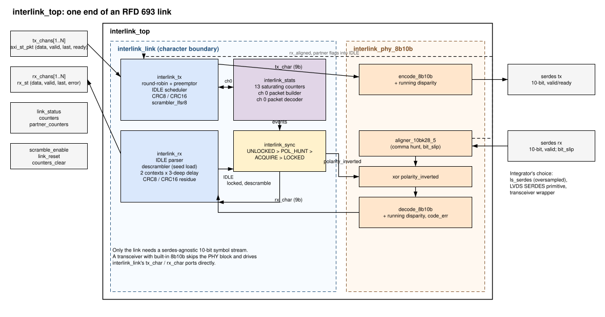
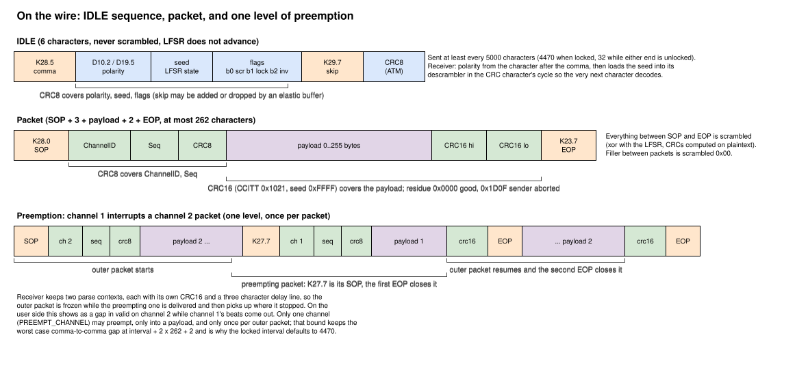

:showtitle:
:toc: left
:numbered:
:icons: font
:revision: 0.1
:revdate: 2026-10-08

= FPGA interlink (RFD 693)

A point-to-point link between two FPGAs carrying packets for several logical
channels over one serial lane each way, as described in RFD 693. This is the
prototype of the common part: everything from the user's packet streams down
to 10-bit 8b10b symbols. The serdes underneath is the integrator's, which is
what lets one implementation serve a slow oversampled GPIO link, an LVDS
SERDES primitive or a transceiver.

== Overview

`interlink_top` is one end of a link. Inside it, `interlink_link` is the link
layer at a character boundary (9 bits: control flag plus data) and
`interlink_phy_8b10b` turns characters into aligned, polarity-corrected 10-bit
symbols. A transceiver with its own 8b10b coder and comma alignment uses
`interlink_link` directly.

[cols="1,3"]
|===
|Block |Role

|`interlink_tx` |Framer. Round-robin arbitration with one preempting channel,
IDLE scheduling, header CRC8, payload CRC16, scrambler, filler.
|`interlink_rx` |Deframer. IDLE parsing, descrambler with seed load, two parse
contexts for preemption, per-channel sequence check, cut-through delivery.
|`interlink_sync` |Lock state machine: comma aligned, polarity read off an
IDLE, good IDLEs counted to lock; bad IDLEs, silence or alignment loss unlock.
|`interlink_stats` |Thirteen saturating counters, the channel 0 statistics
packet and its decoder.
|`interlink_phy_8b10b` |`encode_8b10b`, `decode_8b10b`, `aligner_10bk28_5`
and a 10-bit polarity inversion. Nothing in it depends on the serdes.
|===

Reused from the tree: `scrambler_lfsr8` (both directions), `crc8atm_8wide`,
the 8b10b coders and the comma aligner. New alongside: `crc16_pkg` and
`crc16ccitt_8wide` in `hdl/ip/vhd/crc`, and the `basic_pkt_sink` verification
component.

== On the wire

The framing follows the RFD. Points that the RFD leaves open and this
implementation decides:

* *One preemption per interrupted packet.* The RFD bounds the comma-to-comma
  gap assuming one packet can be interrupted by one other. A preemptor with an
  unbounded supply of packets could otherwise hold the outer packet open
  forever and blow the 5000 character IDLE bound. The preemptor waits at most
  an IDLE plus one maximum packet.
* *The preemptor has strict priority at a packet boundary.* A preemptor that
  always has a packet ready is served back to back and the other channels,
  statistics included, wait. This is a known limitation; the preemptor is
  expected to be a low-duty channel.
* *A preemption only starts inside a payload.* Never in a header or the CRC,
  so the receiver only ever has to freeze one well-defined state.
* *Lock.* `IDLES_TO_LOCK` good IDLEs after the polarity has been read declare
  lock; `BAD_IDLES_TO_UNLOCK` consecutive bad ones, `IDLE_TIMEOUT` characters
  without a good one, or the aligner letting go drop it. Polarity is held
  across a loss of lock and re-evaluated only while unlocked.
* *Sequence numbers after a re-lock.* The transmitter never resets them; the
  receiver forgets its expectations on unlock and the first packet per channel
  after lock re-synchronises silently.
* *Abandoned packets.* A source that drops `valid` mid-packet gets its packet
  closed with the inverted CRC16. That leaves a constant residue (0x1D0F) at
  the receiver, which counts it as `rx_aborted` rather than a CRC error.
* *Undefined control sequences.* K27.7 with nothing to preempt is treated as a
  start of packet; K27.7 while already preempting closes the preempting packet
  as lost and starts another; a comma inside a packet ends it. All of these
  count as framing errors.
* *Code errors and the descrambler.* A symbol the decoder rejects is dropped
  from the parser but still advances the descrambler, because nearly every
  symbol on the wire is a data character (filler included) and skipping the
  advance would put the keystream one step behind. When the corrupted symbol
  was in fact a control character the keystream ends up one step ahead
  instead, and everything until the next IDLE reloads the seed fails its CRC.
  That is bounded by the IDLE interval and is the price of not having
  per-packet scrambler resets.

== Interface

`interlink_top` uses VHDL-2019 mode views; the TX channels are
`axi_st8_pkg.axi_st_pkt_t` and the RX channels and serdes port are views from
`interlink_pkg`. Array index is the ChannelID: user channels are 1 to
`NUM_CHANNELS`, channel 0 is statistics and lives inside the block.

=== Transmit channels

Byte stream with `last`, standard `valid`/`ready`. The one rule: *once a
source has asserted `valid` for a packet it must keep it asserted until the
beat with `last` is taken.* There is no pause character on the wire, so a
stall mid-packet is an underrun: the packet is closed with the abort CRC and
`tx_underruns` counts it. A zero-length packet cannot be expressed on a
last-flagged stream; the receiver accepts them from other implementations and
counts them, but delivers nothing.

=== Receive channels

Push-only and cut-through: `valid`, `last`, `error`, `data`, no `ready`. The
wire cannot be stalled, so a consumer that cannot take a byte per character
slot puts a FIFO behind the port. Payload bytes come out three characters
behind the wire (the receiver has to see what follows a byte to know it was
not the CRC) and `error` is only meaningful on the beat with `last`. A packet
whose header fails its CRC produces no beats at all. A packet interrupted by a
preemption shows a gap in `valid` while the preempting packet's beats come out
on its own channel. Anything that cuts a packet off after beats have been
delivered produces one terminating beat with `last` and `error` set, so a
stream never dangles.

=== Status and counters

`link_status` carries local alignment, lock and polarity plus the partner's
lock, polarity and scrambling flags as last heard in an IDLE. `counters` is
`link_counters_t`, thirteen free-running saturating 16-bit counters, cleared
by `counters_clear`:

[cols="1,3"]
|===
|`rx_pkts` |Header and payload both checked good.
|`rx_crc16_err`, `rx_crc8_err` |Payload and header CRC failures.
|`rx_aborted` |Payload CRC carried the abort residue.
|`rx_framing_err` |Stray EOP, SOP mid-packet, runt, oversize, bad channel, unknown control character, undefined preempt sequences. A statistics packet arriving with `STATS_RX_ENABLE` false is dropped without counting.
|`rx_seq_err` |Sequence number gap on a channel.
|`rx_idle_bad` |IDLE with a bad field or CRC.
|`rx_code_err` |8b10b code or disparity errors.
|`rx_unlocks` |Times lock was lost.
|`tx_pkts`, `tx_preemptions`, `tx_underruns`, `rx_preemptions` |As named.
|===

=== Statistics packet (provisional)

Every `STATS_INTERVAL_IDLES` IDLEs the transmitter sends a snapshot of its
counters on channel 0, 28 bytes: a format byte (0x01), a status flags byte
(bit 0 locked, 1 polarity inverted, 2 scrambling, 3 aligned) and the thirteen
counters big-endian in `link_counters_t` order. The receiver decodes the
partner's into `partner_counters`, pulsing `partner_counters_valid`. Both are
generate-gated (`STATS_INTERVAL_IDLES = 0`, `STATS_RX_ENABLE = false`). The
layout is a placeholder until the RFD settles one.

=== Generics

[cols="2,1,4"]
|===
|Generic |Default |Meaning

|`NUM_CHANNELS` | |User channels.
|`PREEMPT_CHANNEL` |0 |The one ChannelID allowed to preempt, 0 for none.
|`IDLE_INTERVAL_LOCKED` |4470 |Comma to comma, in characters. Asserted at
elaboration to leave room for two maximum packets inside 5000.
|`IDLE_INTERVAL_FAST` |32 |Used while either end reports it is unlocked.
|`IDLES_TO_LOCK`, `BAD_IDLES_TO_UNLOCK` |4, 4 |Lock hysteresis.
|`IDLE_TIMEOUT` |12000 |Characters without a good IDLE before unlocking.
|`STATS_INTERVAL_IDLES`, `STATS_RX_ENABLE` |16, true |Statistics packet cadence and decoder.
|`ALIGN_PATTERNS_TO_LOCK`, `ALIGN_SYMBOLS_BEFORE_SLIP` |3, 64 |Comma aligner acquisition.
|`ALIGN_SYMBOLS_BEFORE_UNLOCK` |15000 |Comma aligner hysteresis. Must exceed the locked IDLE interval by a wide margin.
|===

`scramble_enable` is sampled at the start of each IDLE and applied from the
character after it, so the partner always learns of a change (IDLE flags bit
0) before it has to deal with one. `link_reset` drops lock and realigns.

== The serdes boundary

The `serdes` port is `serdes_link_side`: `tx_data`/`tx_valid`/`tx_ready` and
`rx_data`/`rx_valid`/`rx_ready` as 10-bit symbols, plus `bit_slip`. The link
always has a symbol ready and always takes one the cycle it is offered;
`rx_ready` is advisory. A serdes needs to:

* accept one symbol per symbol time with a `tx_ready` pulse and shift it out
  LSB first;
* present each received 10-bit word with a `rx_valid` pulse, at any
  alignment, and skip one bit on a `bit_slip` pulse.

`ls_serdes` does exactly this and is what the test harness uses. An LVDS
SERDES primitive or a transceiver in raw 10-bit mode fits the same port. A
transceiver that recovers its own clock needs an elastic buffer in front of
this port that adds or drops the K29.7 skip in the IDLE, which is what the
IDLE cadence budget exists for; none is provided here yet. Polarity is
corrected above the serdes by inverting the whole symbol, so the serdes does
not need to know.

A transceiver with its own 8b10b decoder and comma aligner bypasses
`interlink_phy_8b10b` and drives `interlink_link` at the character boundary.
Polarity detection still happens in the link layer (the comma is polarity
symmetric and the inverted polarity characters decode as D12.2/D21.5 through
any decoder), but the correction is then the transceiver's: connect
`interlink_link.polarity_inverted` to its receive polarity control
(RXPOLARITY on Xilinx GTs) and `realign` to its aligner.

== Simulation

[source,bash]
----
buck2 run //hdl/ip/vhd/interlink:interlink_tb          # two ends joined at the 10-bit boundary
buck2 run //hdl/ip/vhd/interlink:interlink_serial_tb   # the same through ls_serdes and serial wires
buck2 run //hdl/ip/vhd/interlink:interlink_tb -- "*preempt*"
buck2 run //hdl/ip/vhd/crc:crc_tb                       # CRC vectors from the RFD
----

`interlink_th` is two `interlink_top` instances, A and B, with a packet source
and a capturing sink on every channel at both ends. Between them sits
`interlink_sim_wire` in each direction, which monitors what the transmitter
sends (IDLE structure, comma cadence against the 5000 bound, packet nesting,
and that each IDLE's seed really descrambles the character after it) and
injects faults on request: a single symbol bit flipped, a symbol dropped or
repeated, a character replaced, or a sequence spliced in, armed on the next
comma or on the next SOP of a given channel.

The bypass bench runs one character per clock, which is the hardest case for
the receiver's handshakes: lock and re-lock, polarity flipped at runtime,
payload lengths at the delay line edges and the maximum, round-robin order,
preemption at every offset through a packet, preemptor saturation, the
locked-rate IDLE cadence under maximum load, scrambling toggled under
traffic, bit errors in header, payload, CRC and IDLE, skip insertion and
deletion, underrun, dropped packets, and raw injection of every error path
the RFD describes. The serial bench covers bit alignment from an arbitrary
phase and inversion of the physical wire.

== Not done yet

* A VHDL-2008 flat-port variant for the yosys/GHDL flow (GHDL has no mode
  views, so this is a port of the core, not a wrapper).
* Serdes wrappers for LVDS primitives and transceivers, and an elastic buffer.
* A register map for the counters, and a settled statistics payload.
* RFD feedback: the one-preemption-per-packet bound, the undefined K27.7
  sequences, zero-length packets on last-flagged streams, and that a code
  error desynchronises the descrambler until the next IDLE whichever way the
  receiver guesses about the advance.
